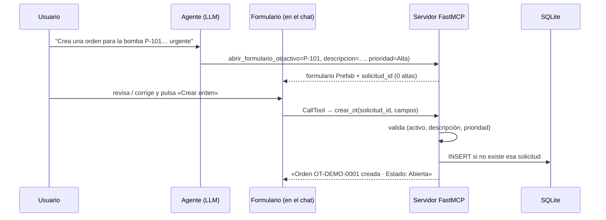

# Cómo presentar la POC (2-3 minutos de demo + preguntas)

## La idea en una frase
> El usuario describe la avería en el chat, el agente le prepara un **formulario precargado**,
> el usuario lo revisa y pulsa **Crear orden**: la OT queda guardada, sin duplicados.

## Cómo funciona (para explicarlo)

Cuatro ideas clave:
1. **Dos herramientas:** `abrir_formulario_ot` la ve el modelo y abre la UI. `crear_ot` solo la ve el formulario y guarda la orden.
2. **La IA solo rellena, no guarda:** el agente propone los datos y es la persona quien confirma.
3. **El servidor manda:** valida todo y genera el ID y el estado, aunque la UI se salte algo.
4. **Sin duplicados:** cada formulario tiene un `solicitud_id`, así que un doble clic devuelve la misma OT.

## Tecnología
- **FastMCP 4.2 + FastMCP Apps** (`FastMCPApp`, `@app.ui`, `@app.tool`, `CallTool`).
- **Prefab UI** para el formulario. Son componentes en Python, sin escribir HTML ni JS.
- **SQLite** local con restricción `UNIQUE` por solicitud.
- **Chainlit** para el chat y **Groq** (LLM) como agente. En VEKAI sería su propio agente. Chainlit no pinta MCP Apps de serie, así que se ha añadido un componente propio (`McpApp.jsx`).
- **Docker** (`docker compose up -d`).

## Guion de la demo

Antes de la reunión: `docker compose --profile visor up -d` y deja abiertas http://localhost:8001 (chat Chainlit) y una terminal en la carpeta.

1. **OT precargada (≈1 min).** En Chainlit, pulsa el botón «OT precargada (P-101)» o escribe: *«Crea una orden para la bomba P-101. Pierde agua por el cierre mecánico y es urgente»*.
   - Señala que P-101, la descripción y la prioridad Alta vienen ya rellenos.
   - Señala «Altas registradas: 0»: abrir el formulario no guarda nada.
   - Pulsa **Crear orden** → *«Orden OT-DEMO-0001 creada · Estado: Abierta»*.
   - Pulsa otra vez → *misma orden, no se duplica*.
2. **Activo a mano (≈1 min).** *«El motor de la cinta hace un ruido metálico al arrancar»*.
   - El activo sale **Pendiente**. Pulsa Crear → el error dice qué falta y lo escrito se conserva.
   - Elige **M-301** y crea → OT-DEMO-0002.
3. **La fila en SQLite (≈30 s).** En la terminal: `docker compose exec mcp python scripts/ver_db.py` (o `python scripts/ver_db.py` en local). Se ven 2 filas, con estado **Abierta**.
4. **(Opcional) Visor oficial.** http://localhost:8080 → `abrir_formulario_ot` → mismo formulario. Es lo que pide el correo con `fastmcp dev apps`.

Si algo falla en directo, tienes el vídeo de respaldo en `docs/demo.mp4` (2 min, enseña todo el flujo del correo).

## Conclusión para la reunión
- **Funciona** el flujo completo: precarga desde el chat, activo pendiente con selector, validación en servidor, mensaje de OT creada y doble envío sin duplicar.
- **Pendiente en VEKAI:** comprobar que su chat pinta MCP Apps y reenvía la llamada de guardado (ver `docs/VEKAI.md`). Si no lo hace, el patrón para añadirlo ya está en `chat/public/elements/McpApp.jsx`.
- **Siguiente paso:** cambiar SQLite por el alta en el sistema real (GMAO/ERP). Solo cambia `db.py`.

## Preguntas probables
- **¿La IA puede crear órdenes sola?** No. `crear_ot` no es visible para el modelo; solo el botón del formulario la llama.
- **¿Y si el agente se equivoca?** El usuario corrige en el formulario y el servidor valida antes de guardar.
- **¿Qué pasa con un doble clic o un fallo de red?** El mismo `solicitud_id` devuelve la misma OT.
- **¿Hace falta API key?** Solo para el chat de demo (Groq). El servidor de la POC no usa IA.
- **¿Por qué Chainlit necesita un componente propio?** Chainlit soporta herramientas MCP de texto, pero no la extensión MCP Apps (pintar la interfaz). `McpApp.jsx` hace ese papel: iframe + puente de mensajes.
- **¿Cuánto cuesta pasarlo a real?** Cambiar `db.py` por la API del sistema real, y que VEKAI actúe como host de MCP Apps.
